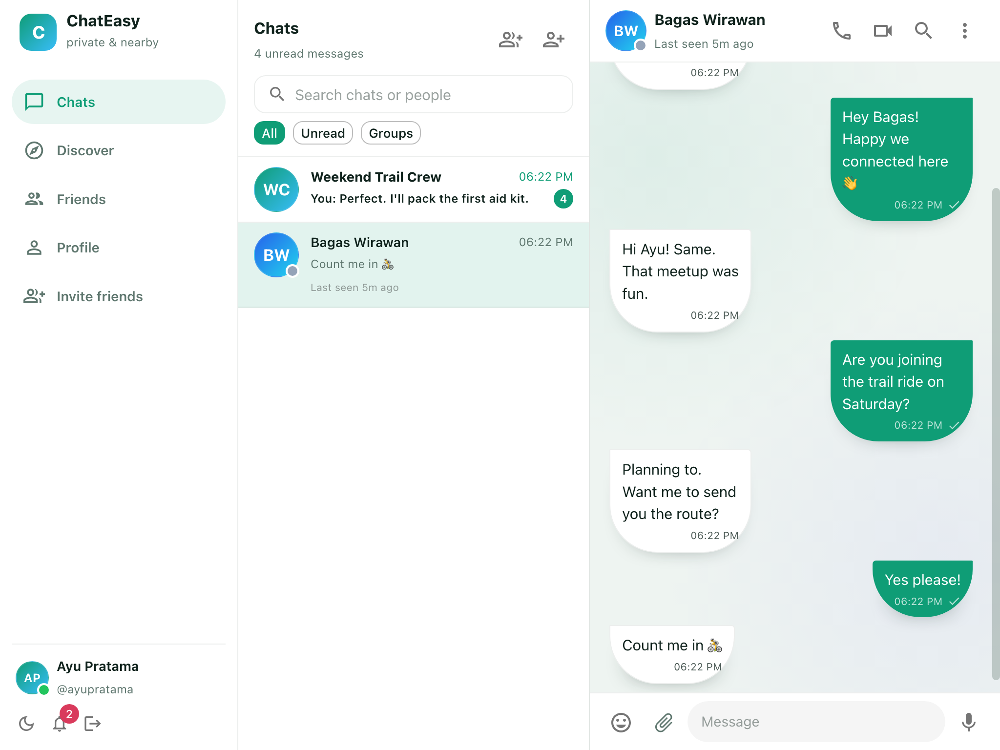
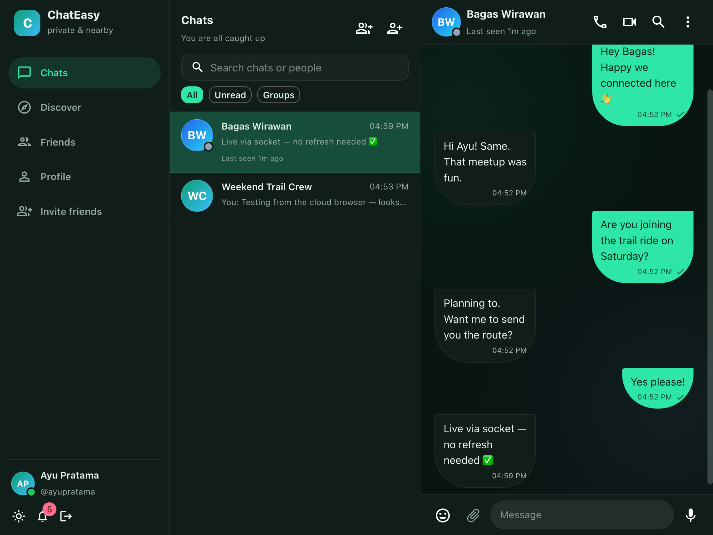
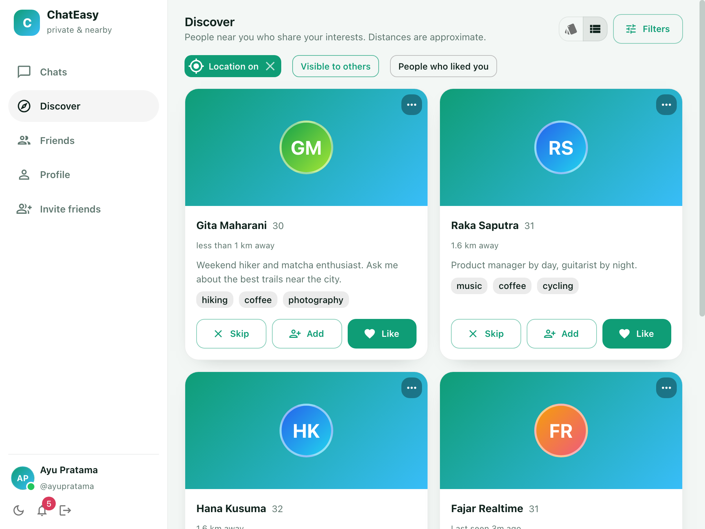
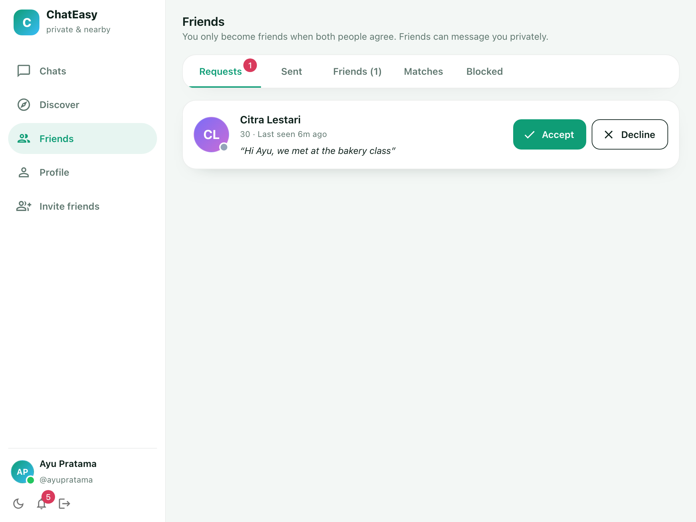

# ChatEasy

A premium social messaging and nearby-friends application: real-time private and group chat,
media sharing, mutual friend approval, swipe/list discovery and voice/video calling.

Built on the project's **existing stack** (React 18 + TypeScript + MUI + Socket.IO on an
Express/Mongoose API). No framework migration was performed and no existing data was removed.

> **A note on the brief's Firebase assumption:** this repository never contained Firebase. There is
> no Firebase SDK, config, Auth instance, Firestore or Storage. Authentication is email + password
> with bcrypt and JWT against MongoDB. The upgrade therefore extends that stack instead of replacing
> it, which is the only way to keep existing accounts and their password hashes working. See
> [`AUDIT.md`](./AUDIT.md) for the full audit.

## Screenshots

| Chats, light | Chats, dark |
| --- | --- |
|  |  |

| Discover | Friends |
| --- | --- |
|  |  |

Screenshots come from the demo data created by `npm run seed:demo`.

## Features

**Authentication** — email/password registration, email verification (with a dev fallback when SMTP
is not configured), resend, forgot/reset password, 7-day JWT sessions hydrated from `/auth/me`,
protected routes, sign-out.

**Messaging** — real-time delivery over authenticated Socket.IO, history with cursor pagination,
delivery/read receipts, typing indicators, presence, replies, editing, soft deletion, forwarding,
emoji reactions, in-conversation search, image/video/audio/document attachments, voice-note recording.

**Groups** — create groups, add/remove members, promote/demote admins, group info, mute/pin, leave.

**Nearby discovery** — List and swipe modes, filters for gender, age, distance (1/5/10/25/50/100 km),
interests and online status, likes-you panel, match dialog, report and block. Location is opt-in and
stored coarsened to roughly a 1 km area — exact coordinates are never persisted or returned.

**Friendship** — request → notification → accept/reject, sent/cancelled requests, friend list,
remove friend, mutual likes/matches, blocked users. Duplicate requests and friendship duplication
are prevented with unique indexes and guarded state transitions.

**Profile & privacy** — avatar and cover upload, name/username/bio/occupation/gender/birthdate,
interests, languages, and per-field privacy (discoverability, age, distance, online status, who may
message you) plus discovery preferences.

**Calls** — WebRTC voice and video calls with incoming-call notifications, accept/decline, mute,
camera toggle and hang-up.

## Architecture

```
src/                     React 18 + TypeScript (Create React App)
  components/            Avatar, AppShell, EmptyState, skeletons, dialogs
  context/               Auth, colour mode (light/dark), toast notifications
  lib/                   API client, socket client, formatting, shared types
  feature/pages/         auth, homepage (chats), discover, friends, profile, invite
  foundation/            reusable chat cards and message bubbles
server/                  Express 4 + Mongoose 7 + Socket.IO 4
  models/                User, Chat, Message, Social (requests, friendships, likes, matches,
                         blocks, reports, notifications, media)
  routes/                auth, users, chats, messages, friends, discovery, notifications, uploads
  middleware/            JWT auth, in-memory rate limiting
  utils/                 validation, geo, presence, notifications, chat service
  scripts/               dev-mongo (in-memory database) and seed-demo (demo data)
docs/screenshots/        README images
```

## API and realtime surface

All REST routes live under `/api` and require `Authorization: Bearer <token>` except the auth
endpoints. Media is read from `/api/media/:id` (it also accepts `?token=` because an `` tag
cannot send headers) and is only served to members of the chat that owns the file.

| Router | Endpoints |
| --- | --- |
| `/auth` | `POST /register`, `/verify`, `/resend`, `/login`, `/forgot`, `/reset`, `/otp/request`, `/otp/verify`, `GET /me` |
| `/users` | `GET /me`, `PUT /me`, `GET /:id`, `GET /`, `GET /suggest`, `POST /invite` |
| `/chats` | `POST /`, `GET /`, `GET /:id`, `PUT /:id`, `DELETE /:id`, `POST /:id/members`, `DELETE /:id/members/:userId`, `POST /:id/admins/:userId`, `GET /:id/messages`, `POST /:id/read` |
| `/messages` | `POST /`, `GET /search`, `GET /:id`, `PUT /:id`, `DELETE /:id`, `POST /:id/reactions`, `POST /:id/read`, `POST /:id/delivered`, `POST /:id/forward` |
| `/friends` | `GET /`, `/requests/received`, `/requests/sent`, `/status/:userId`, `/matches`, `/blocked`, `/likes/received`, `POST /request`, `/request/:id/accept`, `/request/:id/reject`, `/block/:userId`, `/report`, `DELETE /request/:id`, `/friend/:userId`, `/block/:userId` |
| `/discovery` | `GET /`, `/preferences`, `/likes`, `PUT /preferences`, `POST /location`, `/like`, `/skip`, `DELETE /location`, `/swipe/:userId` |
| `/notifications` | `GET /`, `PUT /read-all`, `PUT /:id/read`, `DELETE /:id` |
| `/uploads` | `POST /` (multipart, 12 MB limit), `GET /:id` |

Realtime runs on Socket.IO at the same origin; the handshake carries the JWT and every chat room join
is checked against membership.

| Client → server | Purpose |
| --- | --- |
| `chat:join` / `chat:leave` | Subscribe to a conversation's events |
| `message:new` | Send a message; the server takes the sender from the token and replies with `message:ack` |
| `message:read`, `typing`, `presence:ping` | Read receipts, typing indicator, presence heartbeat |
| `call:invite`, `call:answer`, `call:ice`, `call:reject`, `call:end`, `call:busy` | WebRTC signalling relay |

| Server → client | Purpose |
| --- | --- |
| `message:new`, `message:ack`, `chat:read` | Message delivery, send acknowledgement, read state |
| `chat:created`, `chat:updated`, `chat:removed` | Chat list changes |
| `notification:new` | Friend requests, accepts, group invites, reports |
| `typing`, `presence:changed`, `presence:pong` | Typing and online state |
| `call:incoming`, `call:ended`, `call:rejected`, `call:unavailable`, `call:error` | Call lifecycle |

## Running locally

```bash
# 1. API
cd server
npm install
# required: MONGO_URI, JWT_SECRET  (copy server/.env and fill in)
npm run dev            # http://localhost:5000

# 2. Web app (second terminal)
npm install
npm start              # http://localhost:3000, proxies /api and /socket.io to :5000
```

### Demo data (optional)

To explore the app without registering accounts by hand:

```bash
npm run dev:mongo      # throwaway in-memory MongoDB on 127.0.0.1:27017
# needs: npm install --no-save mongodb-memory-server
# then start the API as above, and in another terminal:
npm run seed:demo      # creates demo people, a chat, a group and pending requests
```

The seed script only talks to the API, so it works against any development database
(`API_URL=... npm run seed:demo`). Every demo account uses the password `DemoPass123!`
(`ayu.demo@chateasy.test` is the one with the populated inbox). Never run it against production.

`server/.env` keys:

| Key | Required | Purpose |
| --- | --- | --- |
| `MONGO_URI` | yes | MongoDB connection string (local or Atlas free tier) |
| `JWT_SECRET` | yes | Signs session tokens |
| `PORT` | no | API port (default 5000) |
| `APP_ORIGIN` | recommended | Origin used in verification / reset / invite links |
| `SMTP_HOST` `SMTP_PORT` `SMTP_USER` `SMTP_PASS` `SMTP_FROM` | no | Verification + reset + invite emails |
| `TWILIO_SID` `TWILIO_AUTH_TOKEN` `TWILIO_WHATSAPP_FROM` | no | WhatsApp OTP and invites |

Without SMTP the API returns the verification/reset token directly so the flow still works in
development; the UI surfaces this instead of pretending an email was sent. Without Twilio the
WhatsApp OTP endpoint returns the code in the response, and invites report that the channel is not
configured (the invite link is always available).

Production build (served by the API when `build/` exists):

```bash
npm run build          # outputs build/
cd server && npm start # serves API + SPA on PORT
```

## Testing

```bash
npx tsc --noEmit                                  # type check
CI=true npx react-scripts test --watchAll=false   # unit tests
npm run build                                     # production build
```

The repository ships one render smoke test. The API and Socket.IO paths were exercised during
development with scripted request and socket suites (auth, chats, messages, friendship, discovery,
notifications, uploads, plus live delivery, presence and typing); those scripts are not committed,
so the backend currently has no test suite you can run from a clean checkout. Adding one is the
highest-value next step for this project.

## Free-tier compatibility

Everything implemented runs on free tiers: MongoDB Atlas M0 (or a local MongoDB) plus any static/Node
host. No paid Cloud Functions, no external queue, no managed realtime service is required — Socket.IO
runs in the API process and media is stored on the API host's filesystem.

Known limitations to plan for:

- **TURN relay for calls.** Calls use public STUN only. Most home networks and many mobile carriers
  work, but symmetric NATs need TURN (coturn self-hosted, or a paid relay). Without it, those calls
  fail to connect — the app reports the failure rather than pretending to connect.
- **Media storage** is local to the API host. Move `routes/uploads.js` to object storage if you scale
  beyond a single instance; nothing else changes.
- **Presence and rate limits** are in-memory (single API process). Use a shared store when scaling out.
- **MongoDB transactions** need a replica set; the code is written with atomic upserts and guarded
  updates so friendship/message consistency does not depend on transactions.

## Security model

- Every chat, message, media and profile route authorises the caller; the API no longer trusts a
  `member`/`sender` id from the client.
- Socket.IO handshake requires a valid JWT; chat rooms are joined only after a membership check, and
  the sender is taken from the token.
- Users can only edit/delete their own profile, messages and friendships; groups are modified by
  admins only.
- Chat media is served through an authenticated handler and is readable only by chat members.
- Uploads are type- and size-limited (12 MB), stored outside the public bundle and never as static files.
- Inputs are trimmed, length-capped and stripped of control characters; user text is always rendered
  as text (React escaping, no HTML injection).
- Auth, invite, messaging and swipe endpoints are rate limited.
- Blocking removes friendships and pending requests in both directions and hides both users from each
  other everywhere.

## Troubleshooting

**`/login` or `/chats` 404s in the browser.** In development the web app proxies everything that is
not a static asset to the API, so a direct `curl` without `Accept: text/html` hits the API and gets a
404 — that is expected. In production the API serves the SPA only when a `build/` directory exists
next to `server/`, so run `npm run build` before `npm start`.

**Realtime does not update until a refresh.** Check the socket connection in devtools: the client
starts on HTTP long-polling and upgrades to WebSocket, so a proxy that blocks upgrades still works.
If no `/socket.io` request is made at all, the API is unreachable — set `REACT_APP_PROXY_TARGET` if it
is not on `http://localhost:5000`.

**Calls ring but never connect.** There is no TURN relay; symmetric NATs and some mobile carriers
cannot establish a peer connection. Configure TURN (see Free-tier compatibility) to fix it.

**Verification or reset emails never arrive.** Without SMTP the API returns the token in the
response and the UI shows it; wire the `SMTP_*` keys to send real mail.
